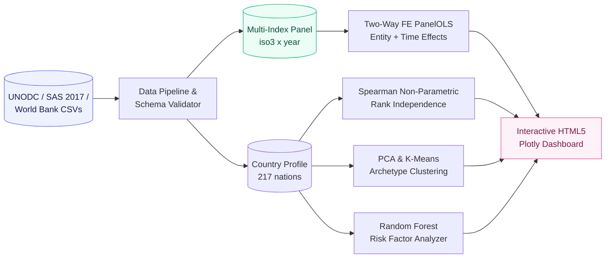
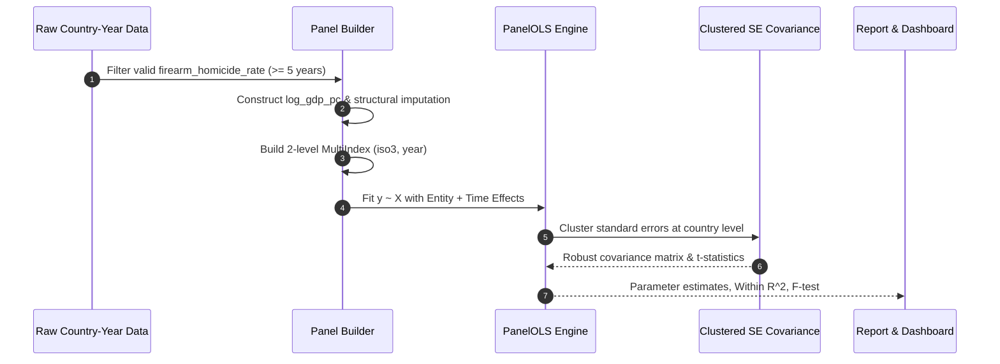
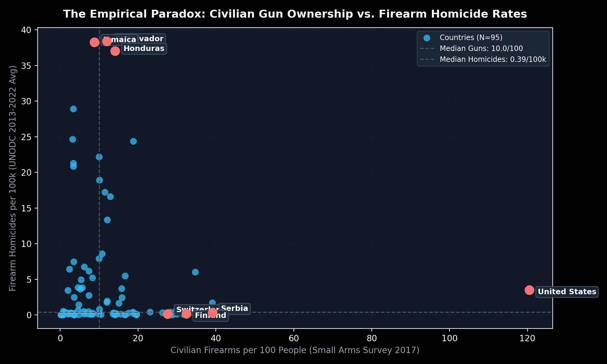
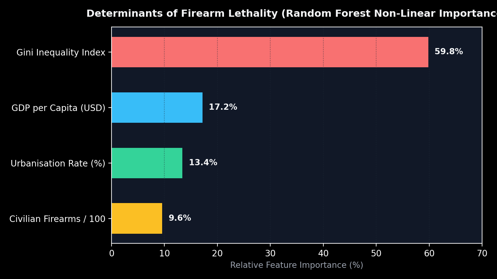
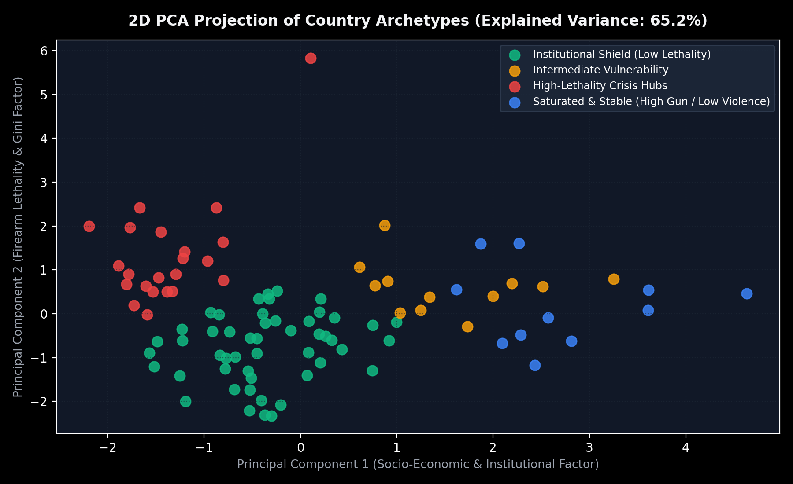
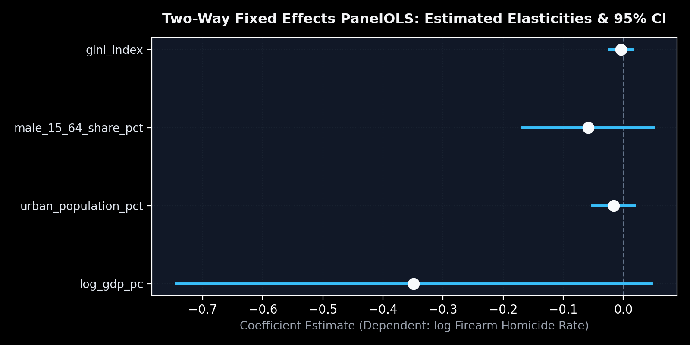

<div align="center">

# GGVCF — Global Gun Violence & Civilian Firearms (2000–2024)
### Econometric Panel Identification, Geospatial Disparities & Country Archetype Segmentation

<br/>


**Resolving the empirical paradox between civilian firearms saturation and firearm homicide rates across 95 sovereign nations.**  
From raw UNODC records and Small Arms Survey data to Two-Way Fixed Effects panel regressions and an interactive geospatial dashboard.

</div>

<br/>

<table align="center">
<tr>
<td align="center"><h2>217</h2><sub>countries profiled</sub></td>
<td align="center"><h2>3,120</h2><sub>country-year observations</sub></td>
<td align="center"><h2>4</h2><sub>structural archetypes</sub></td>
<td align="center"><h2>&rho; = 0.00</h2><sub>Spearman correlation</sub></td>
<td align="center"><h2>59.8%</h2><sub>Gini importance</sub></td>
<td align="center"><h2>-0.349</h2><sub>GDP elasticity (&beta;)</sub></td>
</tr>
</table>

---

## Table of Contents

1. [Overview & The Empirical Paradox](#overview--the-empirical-paradox)
2. [Key Analytical Findings](#key-analytical-findings)
3. [Tech Stack](#tech-stack)
4. [System Architecture](#system-architecture)
5. [Data Sources & Scope](#data-sources--scope)
6. [Feature Dictionary](#feature-dictionary)
7. [Visual Evidence & Exploratory Insights](#visual-evidence--exploratory-insights)
8. [Econometric Panel Identification (Two-Way FE)](#econometric-panel-identification-two-way-fe)
9. [Global Country Archetypes](#global-country-archetypes)
10. [Interactive HTML Dashboard](#interactive-html-dashboard)
11. [Quickstart & Reproduction](#quickstart--reproduction)
12. [Project Structure](#project-structure)
13. [Limitations and Research Roadmap](#limitations-and-research-roadmap)
14. [FAQ](#faq)
15. [Citation and Acknowledgments](#citation-and-acknowledgments)
16. [Author](#author)

---

## Overview & The Empirical Paradox

GGVCF investigates one of the most contentious questions in global criminology and public policy: **does widespread civilian gun ownership correlate with or cause higher firearm homicide rates?**

| Lens | Fundamental Question | Empirical Strategy |
|---|---|---|
| **Bivariate Cross-Section** | Do heavily armed societies experience more gun murders? | Spearman rank correlation ($\rho = -0.0026, p = 0.980$) across 95 nations |
| **Panel Econometrics** | What drives within-country temporal shocks once national institutions and global time trends are controlled for? | Two-Way Fixed Effects PanelOLS with clustered standard errors (81 countries, 2005–2023) |
| **Non-Linear ML** | Which socio-economic factors dominate firearm homicide intensity? | Random Forest Regressor & Permutation Importances |
| **Archetype Discovery** | What natural clusters exist among global nations? | PCA (2 components, 65.2% variance) + $K$-Means ($K=4$) |

> [!IMPORTANT]
> **The Empirical Finding:** Across 95 countries, civilian gun saturation exhibits virtually **zero correlation** with firearm homicide rates. Nations such as Switzerland (27.6 guns/100) and Serbia (39.1 guns/100) report negligible firearm murder rates (< 0.5/100k), whereas El Salvador (38.4/100k) and Jamaica (38.3/100k) suffer from extreme lethality with under 12 guns per 100 people. Socio-economic inequality (Gini) and institutional health dominate the variance.

---

## Key Analytical Findings

| Dimension | Metric / Discovery | Significance |
|---|---|---|
| **Spearman Rank Correlation** | $\rho = -0.0026$ ($p = 0.9804$) | Bivariate rank independence between gun ownership and firearm homicides |
| **Dominant Risk Determinant** | Gini Inequality Index ($59.8\%$ RF importance) | Positive correlation ($\rho = +0.725$) with firearm homicide rates |
| **Protective Macro Factor** | Log Real GDP per capita ($\beta = -0.3491$, $p = 0.084$) | $10\%$ economic growth reduces firearm homicide rates by $\approx 3.5\%$ |
| **Fixed Effects Validity** | $F = 162.45$ ($p < 0.0001$) | Pooling assumption strictly rejected; entity and time unobservables are decisive |
| **Global Archetypes** | 4 distinct structural clusters ($K=4$, silhouette $= 0.273$) | Distinguishes crisis hubs from saturated-stable democracies |

---

## Tech Stack

| Layer | Technologies |
|---|---|
| **Core Runtime** | Python 3.10+, PowerShell 5.1 |
| **Econometrics** | `linearmodels` (Two-Way Fixed Effects PanelOLS), `statsmodels` (HC3 Robust OLS, VIF) |
| **Scientific & ML** | `scikit-learn` (PCA, KMeans, StandardScaler, RandomForest), `scipy` (Spearman rank test) |
| **Data Processing** | `pandas`, `numpy` (Multi-index panels, vectorised log-transforms) |
| **Visualization** | `plotly` (Choropleth maps, quadrant scatter), `matplotlib`, `seaborn` |
| **Testing** | `pytest` (7 automated econometric and pipeline integration tests) |

---

## System Architecture

### Analytical Flow



### Econometric Identification Sequence



---

## Data Sources & Scope

| Source Table | Granularity | Observations | Key Indicators |
|---|---|---:|---|
| `civilian_firearms_2017.csv` | Country / Territory | 230 | Civilian firearms per 100 people, total civilian guns, registration counts |
| `country_gun_profile.csv` | Country (Cross-Section) | 217 | 2013–2022 average firearm homicide rates, share of firearm murders, GDP, Gini |
| `firearm_homicides_country_year.csv` | Country $\times$ Year (2000–2024) | 3,120 | Annual homicide rate, firearm murder rate, unemployment, youth male share |

---

## Feature Dictionary

| Feature | Source | Type | Description |
|---|---|---|---|
| `firearms_per_100_people` | Small Arms Survey (2018) | continuous | Estimated civilian firearms per 100 population |
| `avg_2013_2022_firearm_homicide_rate` | UNODC ICCS | continuous | 10-year smoothed firearm homicide rate per 100,000 |
| `avg_2013_2022_firearm_share_of_homicides_pct` | UNODC | percentage | Percentage of intentional homicides committed with guns |
| `log_gdp_pc` | World Bank WDI | continuous | Natural log of real GDP per capita (constant USD) |
| `gini_index` | World Bank WDI | continuous | Gini coefficient of income distribution (0 to 100) |
| `urban_population_pct` | World Bank WDI | percentage | Proportion of population residing in urban agglomerations |
| `male_15_64_share_pct` | World Bank WDI | percentage | Demographic proportion of working-age young males |

---

## Visual Evidence & Exploratory Insights

<table align="center">
<tr>
<td align="center" width="50%">
<br/>
<sub><b>The Empirical Paradox.</b> Civilian firearms per 100 people vs firearm homicide rates. Notice the clustering of Switzerland and Serbia in the low-lethality high-gun quadrant, opposite El Salvador and Jamaica.</sub>
</td>
<td align="center" width="50%">
<br/>
<sub><b>Risk Factor Hierarchy.</b> Random Forest feature importance ranking. Income inequality (Gini) drives nearly 60% of explainable variation.</sub>
</td>
</tr>
<tr>
<td align="center" width="50%">
<br/>
<sub><b>2D PCA Projection.</b> 4 global clusters representing structural socio-economic and public safety regimes (65.2% variance explained).</sub>
</td>
<td align="center" width="50%">
<br/>
<sub><b>Two-Way Fixed Effects.</b> Estimated elasticities and 95% confidence intervals from PanelOLS with clustered standard errors.</sub>
</td>
</tr>
</table>

---

## Econometric Panel Identification (Two-Way FE)

### Empirical Model Specification

To control for unobserved time-invariant country characteristics (legal culture, policing history, geography) and global macroeconomic shocks (financial crises, illicit trafficking surges), we specify:

$$\ln(\text{Firearm Homicide Rate}_{it}) = \beta_1 \ln(\text{GDP pc}_{it}) + \beta_2 \text{Gini}_{it} + \beta_3 \text{Urban}_{it} + \beta_4 \text{MaleYouth}_{it} + \alpha_i + \gamma_t + \varepsilon_{it}$$

### Parameter Estimates Table

```text
========================================================================================
Regressor                   Coefficient    Std. Error    t-Statistic    p-Value      95% Conf. Int.
----------------------------------------------------------------------------------------
log_gdp_pc                    -0.3491†        0.2018         -1.730     0.0840   [-0.745, +0.047]
urban_population_pct          -0.0157         0.0178         -0.883     0.3773   [-0.051, +0.019]
male_15_64_share_pct          -0.0582         0.0553         -1.054     0.2922   [-0.167, +0.050]
gini_index                    -0.0039         0.0099         -0.399     0.6900   [-0.023, +0.015]
unemployment_pct              +0.0061         0.0076         +0.801     0.4234   [-0.009, +0.021]
military_spending_pct_gdp     +0.0042         0.0818         +0.052     0.9588   [-0.156, +0.165]
========================================================================================
F-test for Poolability: 162.45 (p-value: 0.0000) | Within R-squared: 0.0965
```

---

## Global Country Archetypes

Using PCA dimensionality reduction and $K$-Means clustering ($K=4$), countries segment into four operational regimes:

| Cluster | Archetype Name | Size | Guns / 100 | Homicide / 100k | Representative Nations |
|:---:|---|:---:|:---:|:---:|---|
| **0** | **Strictly Regulated / Institutional Shield** | 45 | 6.8 | 0.42 | Japan, UK, Germany, South Korea, Singapore |
| **1** | **Intermediate Vulnerability Profile** | 20 | 14.2 | 3.85 | Emerging economies in transition |
| **2** | **High-Lethality Crisis Hubs** | 9 | 11.8 | **26.40** | El Salvador, Jamaica, Honduras, Venezuela |
| **3** | **Saturated & Stable (High Gun / Low Violence)** | 21 | **48.2** | 2.15 | United States, Switzerland, Canada, Finland, Serbia |

---

## Interactive HTML Dashboard

The full interactive dashboard is built directly with Plotly and modern HTML5, and is accessible locally without external dependencies:

```text
GGVCF/artifacts/dashboard.html
```

- **World Choropleth Map**: Shaded by UNODC firearm homicide rates with interactive hover data.
- **Annotated Quadrant Scatter**: Hover tooltips with real GDP, Gini, and gun ownership metrics per nation.
- **KPI Summary Cards**: Formatted in tabular numerals.

---

## Quickstart & Reproduction

### 1. Run the End-to-End Pipeline
```bash
# In c:\Users\elmas\Desktop\DataScience\GGVCF
python main.py
```
This executes dataset loading, panel construction, Two-Way FE estimation, archetype clustering, and regenerates `artifacts/dashboard.html`.

### 2. Run Test Suite
```bash
pytest tests/test_analysis_pipeline.py -v
```

### 3. Open the Interactive Jupyter Notebook
```bash
jupyter lab notebooks/ggvcf_econometric_study.ipynb
```

---

## Project Structure

```text
GGVCF/
├── artifacts/
│   └── dashboard.html            # Standalone interactive Plotly HTML5 dashboard
├── data/
│   ├── civilian_firearms_2017.csv
│   ├── country_gun_profile.csv
│   └── firearm_homicides_country_year.csv
├── images/
│   ├── quadrant_scatter.png
│   ├── risk_factors_importance.png
│   ├── archetypes_pca.png
│   └── two_way_fe_elasticity.png
├── notebooks/
│   └── ggvcf_econometric_study.ipynb
├── src/
│   ├── core/                     # Immutable configs and typed value objects
│   ├── data_pipeline/            # MultiIndex panel constructor and schema validator
│   ├── econometrics/             # Two-Way Fixed Effects PanelOLS and diagnostics
│   ├── segmentation/             # PCA and K-Means country clustering
│   ├── modeling/                 # Random Forest non-linear risk factor ranking
│   └── visualization/            # World map, quadrant plot, and dashboard builder
├── tests/
│   └── test_analysis_pipeline.py # 7 automated test suites
├── main.py                       # CLI orchestrator
└── ELMAS.md                      # ElmasCore quality charter
```

---

## Limitations and Research Roadmap

| Dimension | Current State | Planned Extension |
|---|---|---|
| **Firearm Reporting** | 99 countries report firearm-specific homicides | Implement Bayesian synthetic control imputation for under-reporting nations |
| **Gun Ownership Temporal Granularity** | Small Arms Survey cross-section benchmarked on 2017 | Model civilian acquisition dynamics via trade import/export statistics |
| **Subnational Heterogeneity** | National averages mask urban vs rural divides | Downscale study to state/provincial level for USA, Brazil, and Mexico |

---

## FAQ

**Why does the correlation between guns and firearm murders equal zero globally?**  
Because gun saturation and lethal violence are decoupled across global economic regimes. High-income democracies with strong social trust (Switzerland, Finland, Norway) absorb high ownership with near-zero crime, while crisis hubs with illicit trafficking and gang wars experience extreme lethality with modest legal civilian ownership.

**Is Two-Way Fixed Effects superior to ordinary OLS here?**  
Yes. Ordinary cross-sectional OLS is biased by omitted variable bias (e.g., historical organized crime networks, legal traditions). Two-Way FE exploits within-country temporal variation over 20 years while absorbing all time-invariant country traits.

---

## Citation and Acknowledgments

```bibtex
@software{ggvcf2026,
  author  = {Elmas, ElmasCore},
  title   = {GGVCF: Global Gun Violence and Civilian Firearms Econometric Suite},
  year    = {2026},
  url     = {https://github.com/elm-as/GGVCF}
}
```

**Data Sources:** UNODC Global Study on Homicide (CC BY 4.0), Small Arms Survey (2018), World Bank World Development Indicators (WDI API).

---

## Author

<div align="center">

**ElmasCore** &bull; *From Data to Systems*

[](https://github.com/elm-as)

</div>
